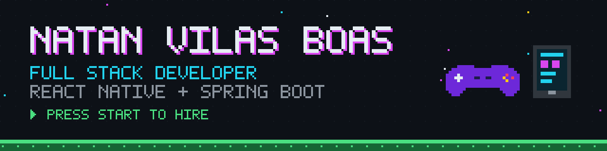

<picture>
  <source media="(prefers-color-scheme: dark)" srcset="./assets/banner-dark.svg" />
  <source media="(prefers-color-scheme: light)" srcset="./assets/banner-light.svg" />
  
</picture>

## Hey, I'm Natan 👋

Full Stack Developer from Botucatu, Brazil. I spend most of my time in **React Native**, and when the app needs an API, I write the **Spring Boot** behind it too.

- 📱 Working on apps with **500k+ downloads**
- 🏗️ Helped migrate an entire React Native app from class components to a modern architecture
- 🧪 Took test coverage from **50% to 90%**, so I enjoy writing tests more than I probably should
- 🎯 Goal: become a **Frontend Tech Lead**
- 🎮 Off the keyboard: games
- 💬 Ask me about **React Native, front-end architecture and testing with Jest**

### 🔭 Right now

- Building a full stack project (React Native + Spring Boot) to open-source here soon
- Exploring on-device AI with React Native

### 📌 Projects

- **[WannaDo](https://github.com/NatanVilasBoas/wanna-do)**: task manager with statuses, filters and charts · React Native, Expo, Firebase
- **[Weather Skia](https://github.com/NatanVilasBoas/wheater-skia)**: weather app with a UI drawn in Skia · React Native, Skia
- **[Banco Spring](https://github.com/NatanVilasBoas/banco-spring)**: REST API for bank accounts, documented with Swagger · Java, Spring Boot, JPA

### 🛠️ Stack

Expo · React Navigation · Redux Saga · React Query · RTK Query · React Hook Form

### 📫 Get in touch

